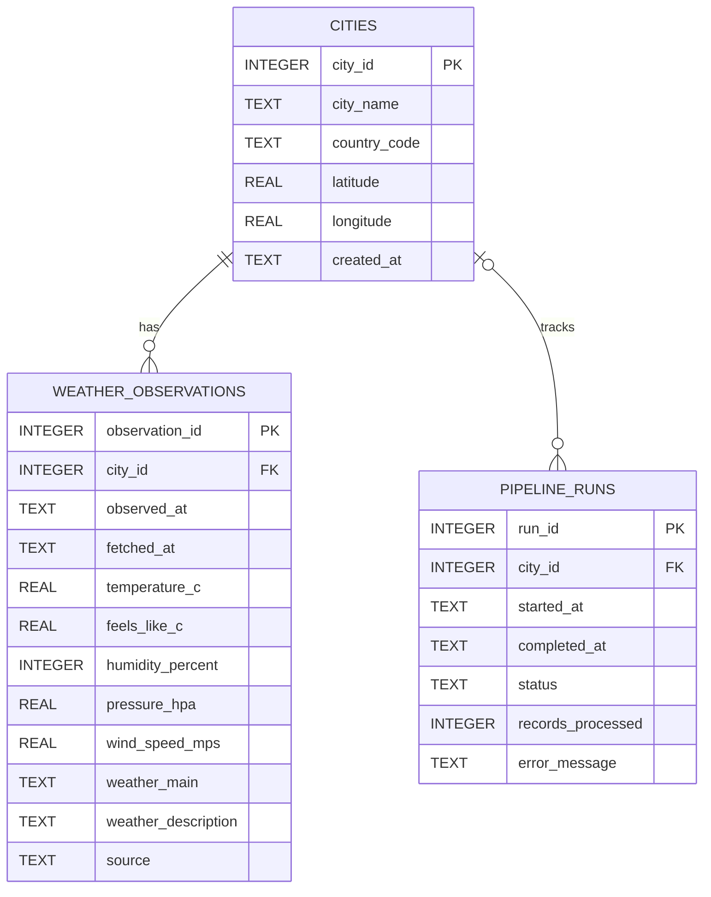

# Database Schema and Normalization

## 1. Overview

The Weather Data Pipeline System uses SQLite to store city information, weather observations, and pipeline execution history.

The database contains three normalized tables:

1. `cities` – Stores city names, country codes, and geographic coordinates.
2. `weather_observations` – Stores time-stamped weather measurements for each city.
3. `pipeline_runs` – Records pipeline execution status, processing counts, and errors.

## 2. Table Structures

### cities

| Column | Data Type | Description |
|---|---|---|
| city_id | INTEGER | Primary key |
| city_name | TEXT | City name |
| country_code | TEXT | Country code |
| latitude | REAL | Geographic latitude |
| longitude | REAL | Geographic longitude |
| created_at | TEXT | Record creation timestamp |

A unique constraint on `city_name` and `country_code` prevents duplicate city records.

### weather_observations

| Column | Data Type | Description |
|---|---|---|
| observation_id | INTEGER | Primary key |
| city_id | INTEGER | Foreign key referencing cities |
| observed_at | TEXT | Weather observation timestamp |
| fetched_at | TEXT | Data retrieval timestamp |
| temperature_c | REAL | Temperature in Celsius |
| feels_like_c | REAL | Feels-like temperature |
| humidity_percent | INTEGER | Relative humidity percentage |
| pressure_hpa | REAL | Atmospheric pressure |
| wind_speed_mps | REAL | Wind speed in metres per second |
| weather_main | TEXT | Main weather condition |
| weather_description | TEXT | Detailed weather description |
| source | TEXT | Data source |

A unique constraint on `city_id` and `observed_at` prevents duplicate observations for the same city and observation timestamp.

### pipeline_runs

| Column | Data Type | Description |
|---|---|---|
| run_id | INTEGER | Primary key |
| city_id | INTEGER | Nullable foreign key referencing cities |
| started_at | TEXT | Pipeline start timestamp |
| completed_at | TEXT | Pipeline completion timestamp |
| status | TEXT | Execution status |
| records_processed | INTEGER | Number of records processed |
| error_message | TEXT | Error details, if any |

The status field supports `running`, `success`, `failed`, and `skipped`.

## 3. Entity Relationship Diagram



## 4. Relationships

- One city can have multiple weather observations.
- One city can be associated with multiple pipeline runs.
- Each weather observation references a city through `city_id`.
- A pipeline run may reference a city or have a NULL city reference.

## 5. Normalization and Data Integrity

The database separates city information from weather measurements to avoid repeating city details for every observation.

Data integrity is maintained through:

- Primary keys for unique record identification.
- Foreign keys for relationships between tables.
- Unique constraints to prevent duplicate cities and observations.
- SQLite foreign-key enforcement on database connections.
- Indexes on city and observation time, and pipeline run start time.

## 6. Example SQL Query

The following query calculates the average recorded temperature for each city and sorts cities from highest to lowest average temperature.

```sql
SELECT
    c.city_name,
    ROUND(AVG(w.temperature_c), 2) AS avg_temp_c
FROM weather_observations w
JOIN cities c ON c.city_id = w.city_id
GROUP BY c.city_id
ORDER BY avg_temp_c DESC;
```

## 7. Database Location

The default database file is:

`database/weather_data.db`

The database schema is also maintained in:

`database/schema.sql`
