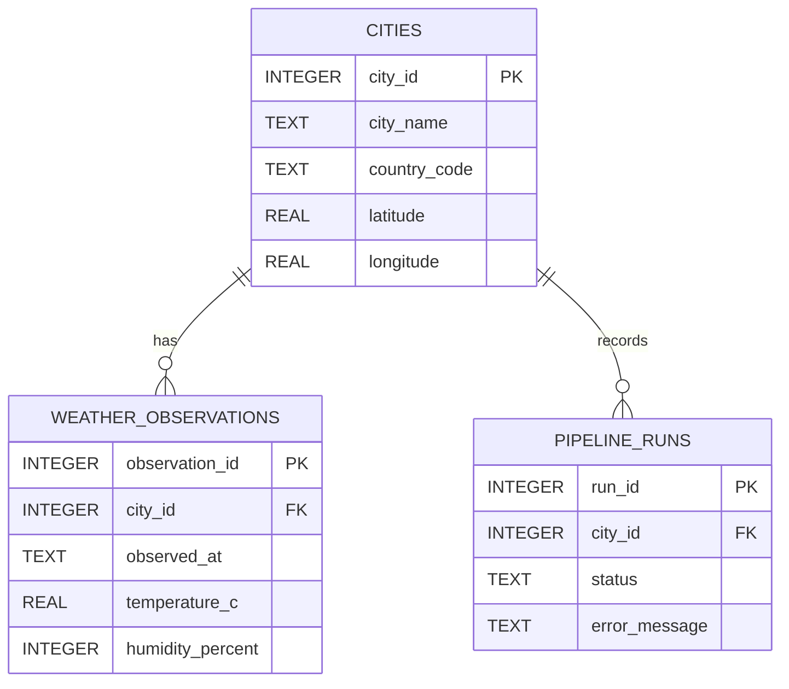

# Database schema and normalization

`cities` stores city identity and coordinates once. `weather_observations` stores multiple time-stamped measurements and references `cities.city_id`. `pipeline_runs` records each attempted city collection, its status, duration timestamps, row count, and error. Foreign keys are enabled per SQLite connection. Unique constraints prevent duplicate city dimensions and duplicate observations per city/source timestamp.



Example query:
```sql
SELECT c.city_name, ROUND(AVG(w.temperature_c),2) AS avg_temp_c
FROM weather_observations w JOIN cities c ON c.city_id=w.city_id
GROUP BY c.city_id ORDER BY avg_temp_c DESC;
```
